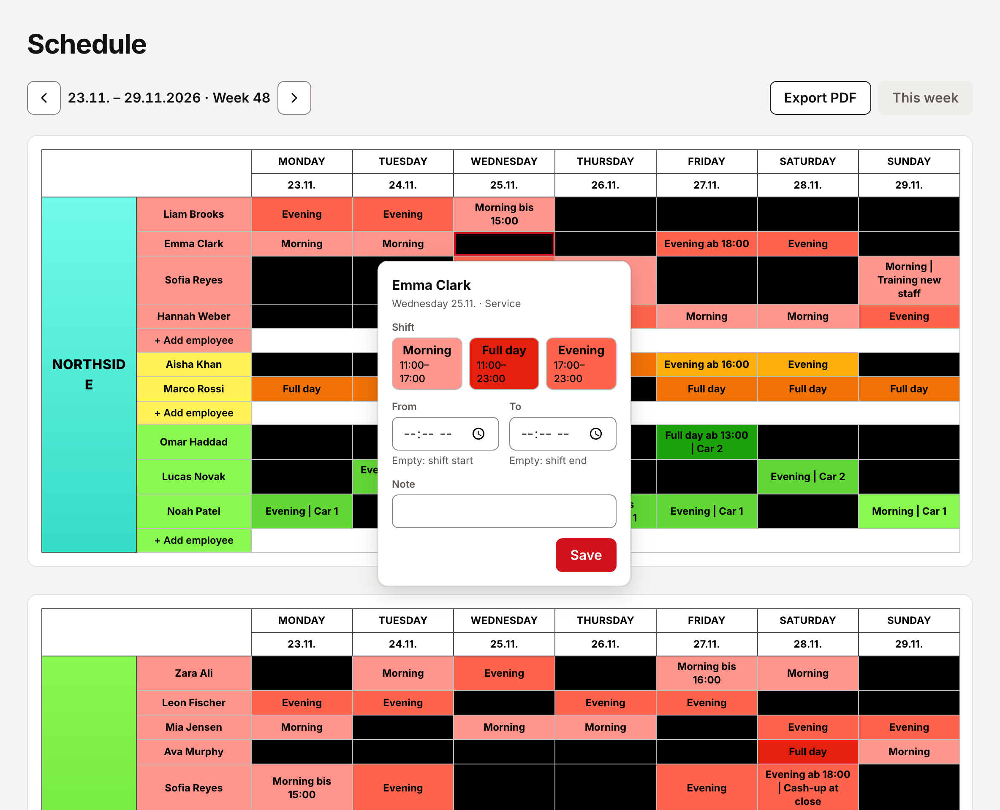
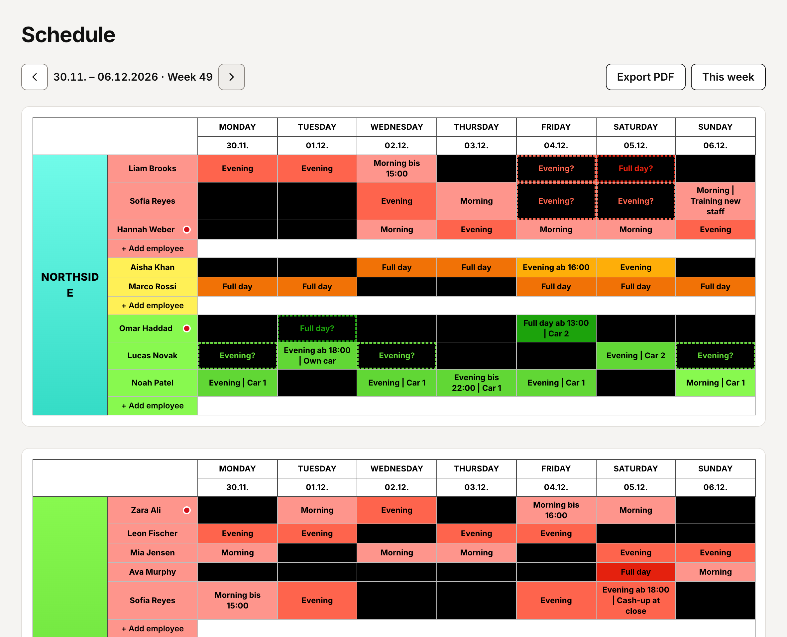
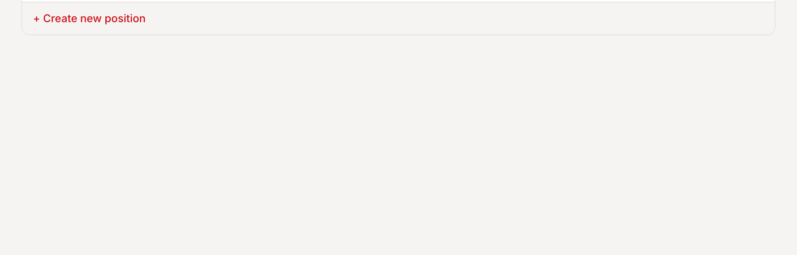
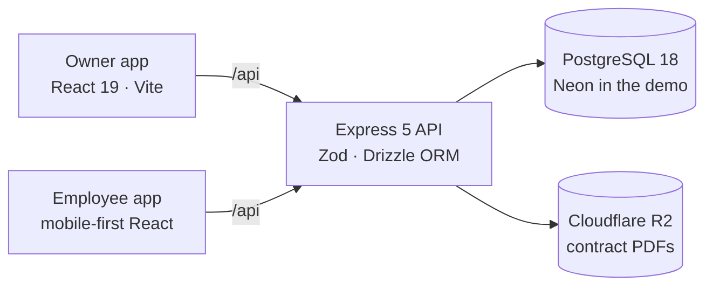

# Pit's Burger: staff scheduling for a restaurant chain

> ## Live demo (fictional data)
>
> | App | Link | Login |
> | --- | --- | --- |
> | **Owner app** | [pitsburger-deployment-tawny.vercel.app/login](https://pitsburger-deployment-tawny.vercel.app/login) | `demo@gmail.com` / `demo123456` |
> | **Employee app** (best on a phone) | [pitsburger-deployment-tawny.vercel.app/employee/](https://pitsburger-deployment-tawny.vercel.app/employee/) | `demo.employee` / `demo123456` |
>
> The demo runs on free-tier hosting, so the first request after a quiet period can take a few seconds. All restaurants and people in it are made up.

> **About this repository:** Pit's Burger is a client project, so the full code base is private. This public repository contains only selected parts of the code, just enough to show the architecture and how I approached the development. It is not runnable on its own.

| Employees' availability appears as dashed suggestions ("Evening?") in the owner's schedule | Positions, each with its own colour |
| --- | --- |
|  |  |

## Overview

Pit's Burger is a scheduling app I'm building for a burger restaurant business with four locations. It has two web apps that share one backend. In the owner app, the owner manages restaurants, opening hours, shifts, positions, contracts and employees, and plans the weekly schedule for every location. In the mobile-friendly employee app, part-time staff submit which days and shifts they can work the following week. A live demo with fictional data runs on Vercel.

## The problem it solves

Before this, the owner planned every week in a large Excel workbook and sent the finished schedule as a PDF over WhatsApp. Tracking who could work when, across four restaurants and staff who work at more than one of them, was manual work, and it was easy to book the same person twice. Now employees submit their availability inside a time window the owner sets, with a limited number of edits. Each submission shows up as a suggestion in the owner's schedule, and the owner can accept, change or dismiss it with one click. The schedule still looks like the Excel sheets the owner knows and can still be exported as a PDF. The difference is that the database stops anyone from being booked for two shifts on the same day, even across restaurants.

## Challenges I faced

The hardest design question was where an employee's availability should appear. Availability belongs to a person, but most employees work several positions in several restaurants, and showing it in every schedule would invite double-booking. I gave each employee one default restaurant, enforced by a partial unique index in PostgreSQL. API rules back it up: if the owner deletes a restaurant or removes one from an employee who still has shifts there, the API returns a 409 listing exactly what blocks the change. The trickiest bug never appeared in local testing. While reviewing the code before production, I found that a helper inside the availability transaction queried the global database object instead of the transaction, so each request grabbed a second connection from the pool. If ten employees submitted at the same moment, every connection would be held by an open transaction waiting for an eleventh that would never free up. This connection pool exhaustion would have frozen the whole API. Passing the transaction into the helper fixed it, and it taught me that every query inside a transaction has to run on that transaction.

**Where to look in the code**

- **The default restaurant and the no-double-booking rule** are database constraints: [`employee_restaurant_one_default_idx`](backend/src/db/schema.ts#L333) (a partial unique index) and [`schedule_entry_employee_id_work_date_key`](backend/src/db/schema.ts#L539) (one entry per employee per day, across restaurants).
- **The connection pool bug:** the save runs [inside one transaction](backend/src/availability/availabilityControllers.ts#L103), and the settings lookup now [receives that transaction](backend/src/availability/availabilityControllers.ts#L119). The helper accepts either `db` or a transaction ([`availabilitySettings.ts`](backend/src/availability/helpers/availabilitySettings.ts#L44)). A [regression test](backend/src/availability/availability.test.ts#L794) saves as many employees at once as the pool has connections.

## Tech stack

The whole project is written in TypeScript. The backend is a REST API built with Node.js, Express 5, Zod for validation and Drizzle ORM on PostgreSQL. It uses cookie-based sessions, bcrypt password hashing and login rate limiting. Both frontends use React 19 with Vite, React Router, TanStack Query for server state, Zustand for client-only state and CSS Modules, with jsPDF for the schedule export. There are over 1,000 unit and integration tests (Vitest, Supertest, Testing Library) and Playwright end-to-end tests in Chromium, WebKit and an iPhone viewport, all running in GitHub Actions CI. The demo runs on Vercel with a Neon PostgreSQL database, and contract PDFs are stored in Cloudflare R2.

## Architecture

Both apps and the API are deployed as one Vercel project (see [`infra/vercel.json`](infra/vercel.json)): `/api` goes to the Express service, `/employee/` to the employee app and everything else to the owner app. A longer walk-through of the conventions is in [ARCHITECTURE.md](ARCHITECTURE.md).

A request through the API always takes the same four steps: **validate** the input with Zod, **authorize** and scope it to the signed-in owner, **query** with Drizzle, **respond** with a named payload (`{ position }`) or `{ error }`.

## Design decisions

**Backend**

- **One folder per feature**, with routes, controllers, a Zod schema and helpers side by side: [`position/`](backend/src/position), [`schedule/`](backend/src/schedule), [`availability/`](backend/src/availability).
- **Validate first, one error shape.** Every controller starts with `safeParse`; every failure is `{ error }`, and validation errors add `fields` so a form can show them under the right input ([`positionControllers.ts`](backend/src/position/positionControllers.ts)).
- **Rules live in the database, not only in code.** Positions can't share a name or a colour per owner. The controller catches the unique violation instead of checking first, so two requests at once can't both succeed, and answers 409 with the field that clashed ([`positionControllers.ts#L32`](backend/src/position/positionControllers.ts#L32)).
- **Auth.** Session tokens are stored only as hashes ([`tokens.ts`](backend/src/auth/helpers/tokens.ts)). Login always runs a bcrypt compare, against a dummy hash when the user doesn't exist, and answers wrong password and unknown account identically ([`authControllers.ts`](backend/src/auth/authControllers.ts#L40)). Failed attempts are rate limited per IP ([`rateLimits.ts`](backend/src/auth/helpers/rateLimits.ts)).
- **Transactions and locks.** Saving availability locks the employee's row and runs every query on the transaction ([`availabilityControllers.ts`](backend/src/availability/availabilityControllers.ts#L103)).
- **Time zones.** Weeks and the availability window are always Europe/Berlin time, whatever the server's zone, including summer time ([`berlinClock.ts`](backend/src/availability/helpers/berlinClock.ts), [`weekStartOf.ts`](backend/src/schedule/helpers/weekStartOf.ts)).

**Frontend**

- **Feature folders with a public surface.** Code outside a feature imports only from its `index.ts` ([`positions/index.ts`](ownerApp/src/features/positions/index.ts)). The schedules feature uses the restaurants and employees features this way; those folders are not part of this excerpt.
- **API functions and query hooks are separate** (`createPosition.ts` plus `useCreatePosition.ts`), all HTTP goes through one [`apiClient`](ownerApp/src/lib/apiClient.ts), and components only use the hooks ([`positions/api/`](ownerApp/src/features/positions/api)).
- **Server state in TanStack Query, client-only state in Zustand.** Server data is never copied into a store; the one store, for rows added to a week before they have entries, is [`addedRowsStore.ts`](ownerApp/src/features/schedules/addedRowsStore.ts).
- **Forms validate on the client with plain functions** and merge in the server's field errors ([`PositionForm/validation.ts`](ownerApp/src/features/positions/components/PositionForm/validation.ts)). The backend stays the source of truth.
- **Route zones and lazy pages.** A visitor is a guest or signed in ([`zones.ts`](ownerApp/src/features/auth/zones.ts)), and every page loads on demand ([`router.tsx`](ownerApp/src/app/router.tsx)).

## Testing and CI

- **Backend:** Vitest and Supertest against a real PostgreSQL test database (`<name>_test`), created, migrated and wiped before every test ([`backend/test/`](backend/test)).
- **Frontends:** Vitest and Testing Library; tests sit next to the code.
- **End to end:** Playwright runs production builds of the API and both apps against its own database, which is dropped and recreated on every run ([`e2e/`](e2e)). Projects cover Chromium for both apps, and in CI also WebKit and an iPhone viewport.
- **CI:** GitHub Actions runs typecheck, tests and builds for each app, and the end-to-end tests once those are green. The workflow is included as a reference in [`infra/ci.yml`](infra/ci.yml). It doesn't run in this repository, because this repository is an excerpt.

## What's in this repo

| Folder | Contents |
| --- | --- |
| [`backend/`](backend) | The API: auth, positions, schedule and availability, the database schema, and the test setup |
| [`ownerApp/`](ownerApp) | The owner app: auth, positions and the weekly schedule, plus shared components |
| [`employeeApp/`](employeeApp) | The employee app: login and availability |
| [`e2e/`](e2e) | Playwright config, support code and two user journeys |
| [`infra/`](infra) | Reference copies of the CI workflow and the Vercel configuration |

Left out on purpose: the other backend features (restaurants, contracts, employees, shifts) and their screens, the generated database migrations, lockfiles, and everything specific to the client's data and accounts. Some imports therefore point at code that isn't here; that is expected.
